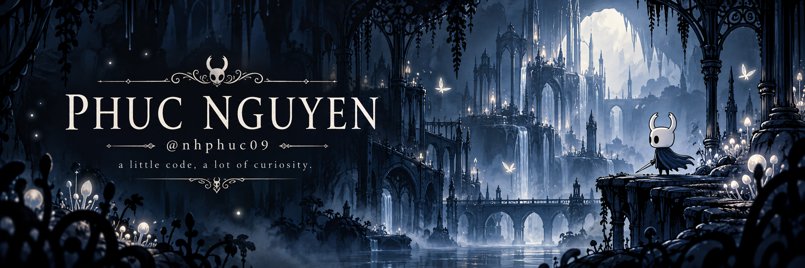

  

<h3 align="center">A traveller's notes</h3>

I'm <strong>Phuc</strong>, a Computer Science graduate interested in software development, practical applications, and learning through hands-on projects.

  

### Charms of the trade

<strong>C# · Java · Python · SQL · Git · Linux</strong>

  

### Contributions in the last year

<!-- profile-stats:start -->
**22 contributions in the last year**

Updated 22 Oct 2026, 04:45 UTC · Refreshes every 6 hours from [GitHub](https://github.com/users/nhphuc09/contributions).
<!-- profile-stats:end -->

  

<em>Every path is a chance to learn.</em> <a href="https://github.com/nhphuc09">@nhphuc09</a>

  

