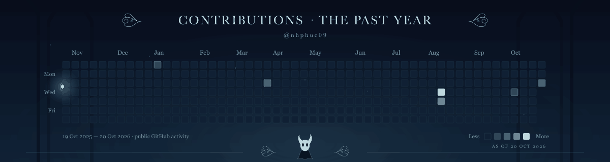

  

<h3 align="center">A traveller's notes</h3>

I'm <strong>Phuc</strong>, a Computer Science graduate interested in software development, practical applications, and learning through hands-on projects.

  

### Charms of the trade

  
  
  
  
  
  

### Contributions in the last year

  

 

<em>Every path is a chance to learn.</em> <a href="https://github.com/nhphuc09">@nhphuc09</a>

  

